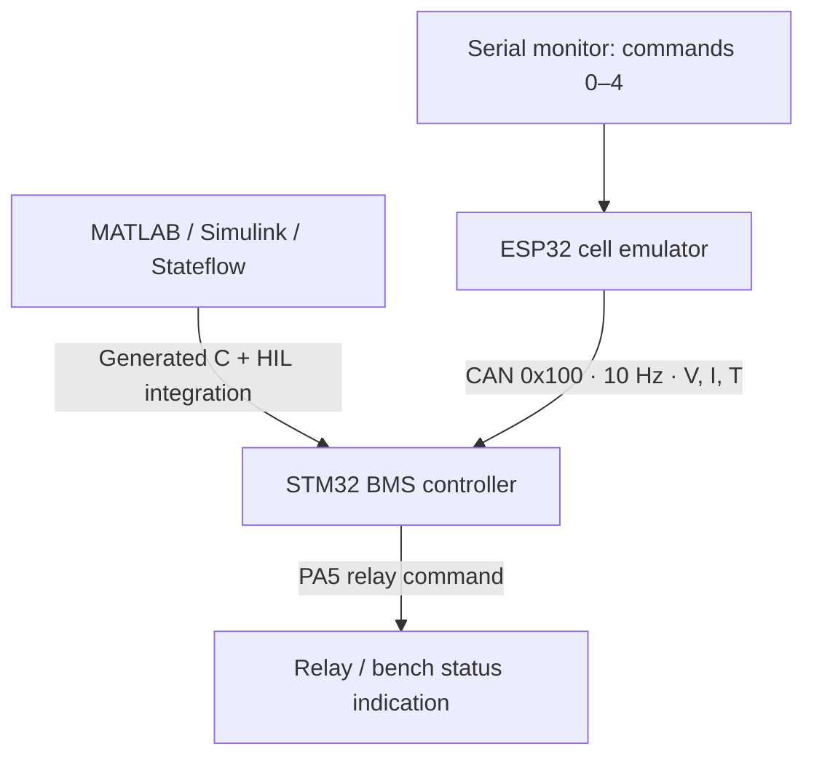

<div align="center">

# Automotive BMS
### Model-Based Design · Embedded Control · CAN HIL

Academic battery-management demonstrator connecting a Simulink controller, neural-network SOC estimation, and a distributed STM32 / ESP32 test bench.

[](https://github.com/seddouki18/Automotive-BMS-MBD-HIL/actions/workflows/host-checks.yml)


[Technical report](docs/TECHNICAL_REPORT.md) · [Getting started](docs/GETTING_STARTED.md) · [CAN interface](docs/CAN_PROTOCOL.md) · [Validation status](docs/FIRMWARE_REVIEW.md)

</div>

## Project at a glance

The project follows an academic V-cycle workflow: model a Li-ion cell, estimate its state of charge, supervise operating limits, generate controller code, and evaluate it through MIL, SIL, PIL, and a CAN-based HIL bench.

| Area | Implementation |
| --- | --- |
| Cell model | Single-cell Thévenin 1-RC model with thermal dynamics |
| SOC estimation | Feedforward ANN; checked-in STM32 C uses a 3 → 12 → 6 → 1 topology |
| Supervision | Stateflow: INIT, NORMAL, DERATING, EMERGENCY_STOP |
| Controller | STM32 NUCLEO-L476RG, generated C with manual HIL integration |
| Plant emulator | ESP32 Node32S, synthetic/driving-current profile and serial fault injection |
| Communication | CAN at 500 kbit/s, standard ID 0x100, 5-byte payload |
| Validation | Historical MIL/SIL/PIL results and six reported HIL scenarios; host regression test for CAN reception |

## Demonstrations

| HIL bench | Processor-in-the-Loop |
| :---: | :---: |
| [](https://github.com/user-attachments/assets/4895109e-6aa9-4a1c-a395-de6a9b9222aa) | [](https://github.com/user-attachments/assets/b72ff9d8-cc0f-4915-b42c-9496ed0b240d) |
| [Watch HIL demo](https://github.com/user-attachments/assets/4895109e-6aa9-4a1c-a395-de6a9b9222aa) | [Watch PIL demo](https://github.com/user-attachments/assets/b72ff9d8-cc0f-4915-b42c-9496ed0b240d) |

## System architecture



The HIL plant does not receive relay or derating feedback. Simulation and HIL therefore have different loop closure; the [technical report](docs/TECHNICAL_REPORT.md) describes this distinction.

## Reported results

These values summarize the existing project evidence. They have not been remeasured after the firmware corrections in this branch.

| Measurement | Reported value | Interpretation |
| --- | --- | --- |
| PIL SOC error | MAE 0.233, RMSE 0.345, max 1.332 percentage points | Nominal 1800 s cycle |
| PIL C coverage | 100% functions, 78% statements | Does not establish full fault-path coverage |
| HIL scenarios | 6/6 reported PASS | Nominal, OVP, UVP, OTP, OCP, CAN loss |
| STM32 DWT timing | Approximately 1.3 ms at 80 MHz | Observed execution timing, not proven WCET |
| Fault-to-relay estimate | Approximately 111.5 ms | Includes assumed relay delay; not measured physical shutdown time |

## Run the host checks

Requires Python 3 and a C compiler (`cc`), with no Python packages to install:

```sh
python3 tests/test_can_callback.py
python3 tests/check_docs.py
```

For MATLAB simulation and the hardware bench, follow [Getting started](docs/GETTING_STARTED.md).

## Reproduction status

The application/generated STM32 headers and Python dashboard source are missing from the current repository. Full target build reproduction is pending restoration of those files. Model sample time, deployed ANN revision, and manually added emergency-stop recovery also need reconciliation before a new PIL/HIL campaign.

See the [firmware review and bench checklist](docs/FIRMWARE_REVIEW.md) for the concrete findings and remaining work.

This is an academic demonstrator inspired by ISO 26262 development practices. No certification, ASIL qualification, or production readiness is claimed.

## Repository guide

| Path | Contents |
| --- | --- |
| [Model_Based_Design_Simulink](Model_Based_Design_Simulink) | Models, MATLAB scripts, training artifacts, reports |
| [Firmware_STM32_Controller](Firmware_STM32_Controller) | STM32CubeIDE project and controller C |
| [Firmware_ESP32_Plant](Firmware_ESP32_Plant) | Cell emulator and profile data |
| [docs](docs) | Technical report, setup, protocol, review, images and videos |
| [tests](tests) | Host integration regression and documentation checks |

See [CONTRIBUTING.md](CONTRIBUTING.md) for change and validation guidance.

## Author

**SEDDOUKI Nacereddine** · Master MST-SER  
Faculty of Sciences and Technology of Al Hoceima  
[GitHub: @seddouki18](https://github.com/seddouki18)
