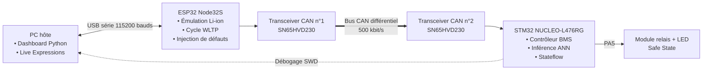

<div align="center">
# Automotive BMS — Model-Based Design & Hardware-in-the-Loop
 
**Estimation du SOC par réseau de neurones, superviseur de sécurité Stateflow et banc de test HIL sur bus CAN**
 
*Embedded Battery Management System · MATLAB/Simulink · STM32L476RG · ESP32 · CAN 2.0B · démarche alignée ISO 26262*
 
[](https://www.mathworks.com/)
[](https://www.st.com/)
[](https://www.espressif.com/)
[](https://en.wikipedia.org/wiki/CAN_bus)
[](https://www.iso.org/standard/68383.html)
 
</div>
---
 
## 🎬 Démonstrations vidéo

Découvrez les principales étapes de validation du système BMS, depuis l'exécution du contrôleur sur STM32 jusqu'aux essais expérimentaux sur le banc Hardware-in-the-Loop (HIL).

### 🎥 Vidéo 1 — Banc HIL en fonctionnement

<p align="center">
  <a href="https://github.com/seddouki18/Automotive-BMS-MBD-HIL/raw/main/docs/video/video2.mp4">
    
  </a>
</p>

<p align="center">
  <a href="https://github.com/seddouki18/Automotive-BMS-MBD-HIL/raw/main/docs/video/video2.mp4"><strong>▶ Regarder la démonstration HIL</strong></a>
</p>

Le banc intègre un **ESP32 Node32S**, une **STM32 NUCLEO-L476RG**, deux transceivers **SN65HVD230**, un relais de sécurité et un dashboard Python. La démonstration illustre l'émulation de la cellule Li-ion, la communication CAN à 500 kbit/s et la surveillance des grandeurs en temps réel.

Les scénarios expérimentaux sont détaillés en Partie 2 : fonctionnement nominal, surtension (OVP), sous-tension (UVP), surchauffe (OTP), surintensité (OCP) et perte de communication CAN.

### 🎥 Vidéo 2 — Validation PIL Simulink ↔ STM32

<p align="center">
  <a href="https://github.com/seddouki18/Automotive-BMS-MBD-HIL/raw/main/docs/video/video3.mp4">
    
  </a>
</p>

<p align="center">
  <a href="https://github.com/seddouki18/Automotive-BMS-MBD-HIL/raw/main/docs/video/video3.mp4"><strong>▶ Regarder la validation PIL</strong></a>
</p>

Cette démonstration présente l'exécution du **code C généré par Embedded Coder** sur la cible STM32L476RG pendant que le modèle de batterie reste sous Simulink. Elle illustre la validation Processor-in-the-Loop du contrôleur, l'estimation du SOC et l'analyse de couverture associée.

---

## Résumé du projet
 
Ce dépôt contient la réalisation complète d’un **calculateur BMS automobile**, depuis la modélisation physique d’une cellule Li-ion jusqu’à sa validation sur un **banc Hardware-in-the-Loop** réel :
 
1. une cellule Li-ion (modèle de Thévenin 1-RC + thermique) est modélisée sous Simulink et excitée par le cycle de conduite **WLTP** ;
2. le **SOC** est estimé par un **réseau de neurones** embarquable (209 paramètres, sans allocation dynamique) ;
3. un **superviseur Stateflow** gère les modes de fonctionnement et les protections (surtension, sous-tension, surchauffe, surintensité, perte de communication) ;
4. le code C est généré avec **Embedded Coder**, validé progressivement en **MIL → SIL → PIL**, puis déployé sur une **STM32L476RG** ;
5. la cellule est ensuite émulée sur un **ESP32** qui dialogue avec la STM32 par **bus CAN 2.0B** ; des défauts sont injectés en temps réel et la réaction du relais de sécurité est mesurée.

### Chiffres clés
 
| Indicateur | Valeur |
| --- | --- |
| Cycle de validation | WLTP, 1800 s |
| Erreur d’estimation du SOC (PIL, code sur STM32) | MAE **0,233 %** · RMSE **0,345 %** · maximum **1,332 %** |
| Temps d’exécution du contrôleur (STM32 @ 80 MHz, compteur DWT) | **≈ 1,3 ms** (≈ 104 000 cycles), soit 1,3 % de la période de 100 ms |
| Couverture du code C (PIL) | fonctions **100 %** · instructions **78 %** |
| Essais HIL | **6 / 6** scénarios réussis (nominal, 4 défauts, perte du bus CAN) |
| Chaîne de sécurité, estimation du pire cas (hypothèses ci-dessous) | **≈ 111,5 ms** pour un budget FTTI de référence de 500 ms (marge 77,7 %) |
 
> **Portée.** Projet académique réalisé selon une démarche **alignée sur l’ISO 26262-6** (traçabilité, tests MIL/SIL/PIL/HIL, couverture structurelle). Aucune certification ni homologation n’est revendiquée.
 
---
 
## Sommaire
 
- [Partie 1 — Model-Based Design : du modèle Simulink au PIL](#partie-1--model-based-design--du-modèle-simulink-au-pil)
  - [1.1 Démarche de validation](#11-démarche-de-validation)
  - [1.2 Modèle électro-thermique de la cellule (Plant)](#12-modèle-électro-thermique-de-la-cellule-plant)
  - [1.3 Estimation du SOC par réseau de neurones](#13-estimation-du-soc-par-réseau-de-neurones)
  - [1.4 Superviseur de sécurité Stateflow](#14-superviseur-de-sécurité-stateflow)
  - [1.5 Génération de code et configuration de la cible](#15-génération-de-code-et-configuration-de-la-cible)
  - [1.6 Résultats MIL / SIL / PIL](#16-résultats-mil--sil--pil)
- [Partie 2 — Banc HIL et validation technique](#partie-2--banc-hil-et-validation-technique)
  - [2.1 Architecture distribuée du banc](#21-architecture-distribuée-du-banc)
  - [2.2 Protocole CAN](#22-protocole-can)
  - [2.3 Firmware du Plant (ESP32)](#23-firmware-du-plant-esp32)
  - [2.4 Firmware du contrôleur (STM32)](#24-firmware-du-contrôleur-stm32)
  - [2.5 Matrice de test et résultats expérimentaux](#25-matrice-de-test-et-résultats-expérimentaux)
  - [2.6 Performance temps réel et budget FTTI](#26-performance-temps-réel-et-budget-ftti)
  - [2.7 Problèmes rencontrés et solutions](#27-problèmes-rencontrés-et-solutions)
- [Structure du dépôt](#structure-du-dépôt)
- [Reproduire le projet](#reproduire-le-projet)
- [Limites et perspectives](#limites-et-perspectives)
- [Auteur](#auteur)
---
 
# Partie 1 — Model-Based Design : du modèle Simulink au PIL
 
## 1.1 Démarche de validation
 

 
Le modèle de niveau supérieur `BMS_controller.slx` sépare nettement l’**environnement** (`Plant_Battery`) du **contrôleur** (`Controller_BMS`). Le relais de sécurité commandé par le contrôleur est ramené dans le plant : lorsqu’il s’ouvre, le courant imposé à la cellule tombe à 0 A. La boucle de sécurité est donc réellement fermée dès la simulation.
 
<p align="center">
  
</p>

## 1.2 Modèle électro-thermique de la cellule (Plant)
 
Modèle de Thévenin à un réseau RC, couplé à un modèle thermique du premier ordre et à un comptage coulombien pour la vérité terrain du SOC :
 
`V_cell(t) = V_oc(SOC) - R_0 × I(t) - V_1(t)`
 
`dV_1/dt = -V_1/(R_1 × C_1) + I/C_1`  
`dSOC/dt = -I/C_n`
 
`C_th × dT_cell/dt = R_0 × I² - hA × (T_cell - T_amb)`
 
Convention : `I > 0` en décharge, `I < 0` en freinage régénératif. La tension à vide `V_oc(SOC)` est une table non linéaire sous Simulink et une approximation polynomiale dans le firmware ESP32.
 
| Paramètre | Symbole | Valeur |
| --- | --- | --- |
| Capacité nominale | C_n | 2,50 Ah (9 000 As) |
| Résistance interne ohmique | R_0 | 20 mΩ |
| Résistance de polarisation | R_1 | 15 mΩ |
| Capacité de polarisation | C_1 | 1 200 F (τ = R_1C_1 = 18 s) |
| Capacité thermique globale | C_th | 65 J/°C |
 
<p align="center">
  
</p>
Le bloc `cell_physics` calcule les dérivées (`V1_dot`, `T_dot`, `soc_dot`) ; les intégrateurs ferment la boucle d’état. Le relais agit comme un interrupteur sur la demande de courant.
 
## 1.3 Estimation du SOC par réseau de neurones
 
Le comptage de Coulomb seul dérive à cause du bruit de mesure intégré au cours du temps. Un perceptron multicouche léger estime le SOC directement à partir des mesures :
 
| Élément | Description |
| --- | --- |
| Entrées (3) | Courant, tension, température normalisés dans [0, 1] |
| Couche cachée 1 | 16 neurones, ReLU |
| Couche cachée 2 | 8 neurones, ReLU |
| Sortie (1) | SOC ∈ [0, 1], sigmoïde |
| Taille | **209 paramètres** : (3×16+16) + (16×8+8) + (8×1+1) |
 
Le comptage de Coulomb seul s’écrit :
 
`SOC_coulomb(t) = SOC(t_0) - (1/C_n) × ∫[t_0 → t] (I(τ) + ε_bruit) dτ`
 
Le terme d’offset et de bruit `ε` du capteur de courant est intégré avec le temps, d’où la dérive. Le réseau évite cette intégration : il calcule le SOC directement à partir des mesures, par une inférence directe :
 
`z_1 = ReLU(W_1 × x + b_1)`  
`z_2 = ReLU(W_2 × z_1 + b_2)`  
`SOC_est = σ(W_3 × z_2 + b_3)`
 
L’apprentissage est réalisé sous Deep Learning Toolbox (`RNA.m`). Les poids sont ensuite extraits (`extract_weights.m`) sous forme de tableaux `const float` et l’inférence est écrite en C pur (`soc_nn_core.m`) : pas de `malloc`, pas de boucle dépendante des données, donc un nombre de cycles constant d’une exécution à l’autre. Un limiteur de pente (`Rate Limiter`) lisse la sortie `soc_est`.
 
## 1.4 Superviseur de sécurité Stateflow
 
`Controller_BMS` regroupe l’estimateur de SOC et un automate Stateflow qui produit `derating`, `fault_code` et `relay`.
 
<p align="center">
  
</p>
Le chart comporte quatre états ; les sorties sont fixées à l’entrée de chaque état.
 
<p align="center">
  
</p>

| État | `relay` | `derating` | `fault_code` | Rôle |
| --- | :---: | :---: | :---: | --- |
| `INIT` | 0 | 0 | 0 | Initialisation, relais ouvert ; passage en `NORMAL` après 10 pas de calcul (`after(10, tick)`) |
| `NORMAL` | 1 | 0 | 0 | Relais fermé, surveillance continue de V, I, T |
| `DERATING` | 1 | 1 | 0 | Limitation préventive de puissance, relais maintenu fermé |
| `EMERGENCY_STOP` | 0 | 0 | 1 | Safe State : relais ouvert |
 
| Transition | Condition |
| --- | --- |
| `NORMAL` → `DERATING` | T ≥ 45 °C **ou** SOC estimé ≤ 15 % |
| `DERATING` → `NORMAL` | T < 42 °C **et** SOC estimé > 20 % (hystérésis) |
| `NORMAL` / `DERATING` → `EMERGENCY_STOP` | V > 4,25 V **ou** V < 2,5 V **ou** T ≥ 55 °C **ou** I ≥ 10 A |
 
| Défaut | Condition de déclenchement | Où est-il détecté |
| --- | --- | --- |
| Surtension (OVP) | V_cell > 4,25 V | Chart Stateflow |
| Sous-tension (UVP) | V_cell < 2,5 V | Chart Stateflow |
| Surchauffe (OTP) | T_cell ≥ 55 °C | Chart Stateflow |
| Surintensité (OCP) | I_cell ≥ 10 A (courant de décharge) | Chart Stateflow |
| Perte de communication CAN | Aucune trame pendant plus de 300 ms | Watchdog du firmware STM32 (`main.c`) |
 
Dans le chart, `EMERGENCY_STOP` est un état verrouillé : il n’a pas de transition de sortie. Pour enchaîner les essais sur banc sans réinitialiser la carte, une logique de sortie (retour à des grandeurs saines, commande `0`) a été ajoutée dans `Controller_BMS.c`.
 
## 1.5 Génération de code et configuration de la cible
 
Le code est généré avec **Embedded Coder** (`ert.tlc`) pour la carte NUCLEO-L476RG via le support package STM32 : build, chargement et exécution par ST-LINK / SWD, bibliothèque d’exécution *Reduced C* (`nano.specs`).
 
<p align="center">
  
</p>
Le projet **STM32CubeMX** associé configure le bus CAN (bxCAN, 500 kbit/s : prescaler 10, 13 + 2 quanta de temps autour du quantum de synchronisation, soit 16 quanta par bit) et les broches utilisées par le banc.
 
<p align="center">
  
</p>

| Broche | Fonction |
| --- | --- |
| PA11 / PA12 | CAN1_RX / CAN1_TX (vers le transceiver SN65HVD230) |
| PA5 | Commande du relais et LED LD2 (Safe State) |
| PA2 / PA3 | USART (liaison série ST-LINK) |
| PA13 / PA14 | SWDIO / SWCLK (programmation et débogage) |
 
## 1.6 Résultats MIL / SIL / PIL
 
Les mêmes vecteurs d’excitation WLTP sont appliqués au modèle (MIL), au code C compilé sur l’hôte (SIL, comparaison *back-to-back*) puis au code exécuté sur la STM32 (PIL). Cette démarche permet de vérifier progressivement le comportement fonctionnel, l’exécution du code généré et son fonctionnement sur la cible réelle.

### Validation MIL (Model-in-the-Loop)

En mode **MIL**, les algorithmes du contrôleur (`Controller_BMS`) sont évalués directement dans l’environnement MATLAB/Simulink, en boucle fermée avec `Plant_Battery`. Ce niveau sert de référence fonctionnelle : comportement de l’estimation du SOC, transitions Stateflow et commande du relais face au modèle de cellule.

### Validation SIL (Software-in-the-Loop)

En mode **SIL**, le code C généré à partir de `Controller_BMS` par Embedded Coder est compilé puis exécuté sur l’ordinateur hôte, tout en restant connecté au plant simulé. La comparaison *back-to-back* entre MIL et SIL vise à détecter les écarts éventuellement introduits par la génération de code, les types numériques ou l’exécution du logiciel produit.

Le SIL constitue ainsi une étape intermédiaire entre la validation du modèle et l’exécution sur microcontrôleur. Il ne remplace pas les tests PIL/HIL : la cible et les périphériques réels ne sont pas encore sollicités.

<p align="center">
  
</p>

### Validation Back-to-Back (MIL vs SIL)

La comparaison directe entre la simulation du modèle (**MIL**) et l’exécution du code C compilé (**SIL**) dans le *Simulation Data Inspector* montre **2 Match, 0 Mismatch** sur les signaux comparés pendant les **1800 s** du cycle WLTP. Les courbes superposées et l'écart représenté dans la fenêtre de comparaison illustrent la concordance des deux exécutions pour ce scénario et les tolérances configurées.

<p align="center">
  
</p>

Ce résultat est un contrôle de non-régression pour les signaux effectivement comparés ; il ne signifie pas à lui seul que tous les chemins de sécurité ont été exercés. Les validations **PIL** sur STM32 et **HIL** sur bus CAN complètent la démarche.

### Validation PIL (Processor-in-the-Loop) — STM32L476RG

En mode **PIL**, le code généré est exécuté sur le cœur ARM Cortex-M4F de la STM32L476RG, pendant que le modèle de batterie et la campagne de simulation restent sur l’ordinateur hôte. Cette étape vérifie le comportement du programme compilé pour la cible et permet d’en observer les performances sur le matériel.

L’estimation du SOC suit la référence sur les 1800 s du cycle (SOC passant d’environ 95 % à 63 %).
 
<p align="center">
  
</p>
L’erreur absolue reste inférieure à 1,4 point de pourcentage sur tout le cycle ; elle augmente en fin de cycle, lorsque les sollicitations en courant deviennent plus marquées.
 
<p align="center">
  
</p>

| Métrique (PIL, STM32L476RG) | Valeur | Critère d’acceptation du projet |
| --- | --- | --- |
| Durée du cycle WLTP | 1800 s (cycle complet) | 1800 s |
| Erreur maximale ΔSOC | 1,332 % | < 3,0 % |
| Erreur moyenne (MAE) | 0,233 % | < 1,0 % |
| Erreur quadratique moyenne (RMSE) | 0,345 % | < 1,5 % |
| Couverture des fonctions (code C) | 100 % | 100 % |
| Couverture des instructions (code C) | 78 % | > 70 % |
 
La simulation PIL est exécutée avec **Simulink Coverage** activé : le bloc `Controller_BMS (PIL)` tourne sur la cible pendant que le reste du modèle reste sur l’hôte. Les zones en rouge indiquent les éléments non exercés par ce cycle nominal ; les chemins de défaut sont exercés séparément lors de la campagne HIL (Partie 2). Le rapport de couverture MC/DC est fourni dans `Model_Based_Design_Simulink/Rapport_Coverage_Securite_MCDC.html`.
 
<p align="center">
  
</p>

<p align="center">
  
</p>
---
 
# Partie 2 — Banc HIL et validation technique
 
## 2.1 Architecture distribuée du banc
 
La cellule est sortie de la simulation et émulée en temps réel sur un microcontrôleur dédié. Le contrôleur BMS ne reçoit plus que des trames CAN, exactement comme dans un véhicule.
 

 
<p align="center">
  
</p>

| Sous-ensemble | Référence matérielle | Rôle |
| --- | --- | --- |
| Plant (émulateur) | ESP32 Node32S (double cœur, 240 MHz) | Émulation de la cellule, profil WLTP, injection de défauts |
| ECU BMS | NUCLEO-L476RG (Cortex-M4F, 80 MHz) | Exécution du code généré, diagnostics de sécurité, commande du relais |
| Transceivers CAN | 2 × SN65HVD230 | Adaptation 3,3 V vers les lignes différentielles CANH / CANL |
| Actionneur de sécurité | Module relais 1 voie + LED verte d’état | Ouverture du circuit en Safe State, état du relais visible à distance |
| Poste de supervision | PC | Dashboard Python, injection de scénarios, STM32CubeIDE |
 
## 2.2 Protocole CAN
 
Le bus opère à **500 kbit/s**. L’ESP32 diffuse toutes les **100 ms** (10 Hz) une trame standard d’identifiant `0x100` :
 
```text
ID : 0x100 | DLC : 5 | identifiant standard 11 bits | octets en big-endian
```
 
| Octets | Signal | Type | Résolution | Plage physique |
| --- | --- | --- | --- | --- |
| 0 – 1 | Tension de cellule | `uint16_t` | 1 mV / bit | 0 à 65,535 V |
| 2 – 3 | Courant de cellule | `int16_t` | 10 mA / bit (1 cA) | −327,68 à +327,67 A |
| 4 | Température | `int8_t` | 1 °C / bit | −128 à +127 °C |
 
Le courant est transmis en **centiampères** : exprimé en mA, un `int16_t` plafonne à ±32,767 A et 35 A déborderait ; en cA, la plage atteint ±327,67 A. Côté STM32, le décodage divise la tension par 1000 et le courant par 100.
 
## 2.3 Firmware du Plant (ESP32)
 
Fichiers : `Firmware_ESP32_Plant/BMS_Plant_ESP32.ino` et `wltp_data.h`.
 
- Boucle déterministe à 10 Hz : lecture du profil de courant WLTP, comptage de Coulomb, dynamique RC, calcul de la tension et modèle thermique simplifié.
- Pilote **TWAI** (contrôleur CAN de l’ESP32) configuré à 500 kbit/s.
- Injection de défauts en direct par liaison série :
| Commande | Scénario | Grandeur forcée |
| --- | --- | --- |
| `0` | Nominal | profil WLTP |
| `1` | Surtension (OVP) | V_cell = 4,30 V |
| `2` | Surchauffe (OTP) | T_cell = 60 °C |
| `3` | Sous-tension (UVP) | V_cell = 2,20 V |
| `4` | Surintensité (OCP) | I_cell = 35 A |
 
## 2.4 Firmware du contrôleur (STM32)
 
Fichiers : `Firmware_STM32_Controller/BMS_STM32_HIL/Core/Src/main.c` et `Controller_BMS.c` (code généré).
 
- **Réception pilotée par interruption** : `HAL_CAN_RxFifo0MsgPendingCallback()` filtre l’identifiant `0x100`, décode la trame et alimente directement les entrées du modèle (`Controller_BMS_U.V_cell`, `.I`, `.T`).
- **Un pas de calcul par trame** : `Controller_BMS_step()` exécute l’estimateur de SOC et le Stateflow ; la sortie `Controller_BMS_Y.relay` pilote la broche PA5.
- **Watchdog de communication** : l’horodatage de la dernière trame valide est comparé à `HAL_GetTick()` ; au-delà de 300 ms sans trame, le relais est ouvert (repli sécurisé).
- **Mesure de performance** : compteur de cycles matériel `DWT->CYCCNT` autour de l’exécution du modèle.

## 2.5 Matrice de test et résultats expérimentaux
 
### Matrice de validation
 
| Test | Événement | Valeur injectée (ESP32) | Seuil de détection (STM32) | Action de sécurité (PA5 / relais) | Résultat |
| --- | --- | --- | --- | --- | --- |
| TC-01 | Roulage nominal | Profil WLTP | Grandeurs dans les plages sûres | Relais fermé, LED externe éteinte (LD2 selon PA5) | **PASS** |
| TC-02 | Surtension (OVP) | V_cell = 4,30 V | V_cell > 4,25 V | Coupure immédiate | **PASS** |
| TC-03 | Surchauffe (OTP) | T_cell = 60,0 °C | T_cell ≥ 55,0 °C | Coupure immédiate | **PASS** |
| TC-04 | Sous-tension (UVP) | V_cell = 2,20 V | V_cell < 2,50 V | Coupure immédiate | **PASS** |
| TC-05 | Surintensité (OCP) | I_cell = 35,0 A | I_cell ≥ 10,0 A | Coupure immédiate | **PASS** |
| TC-06 | Perte du bus CAN | Déconnexion de CANH | Timeout > 300 ms | Repli sécurisé | **PASS** |
 
### Télémétrie du dashboard pendant l’injection de défauts
 
Le dashboard Python affiche en temps réel V, I, T et SOC ; le bouton vert indique le scénario actif. Chaque capture montre l’instant où le défaut est appliqué.
 
| **Surtension (OVP)** : à t ≈ 815 s, la tension passe à 4,30 V, au-dessus du seuil de 4,25 V. | **Sous-tension (UVP)**, première campagne : tension forcée à 2,50 V, égale au seuil strict (V < 2,5 V) ; la valeur injectée a ensuite été abaissée à 2,20 V. |
| :---: | :---: |
|  |  |
 
| **Surintensité (OCP)** : à t ≈ 583 s, le courant passe à 35 A ; la tension chute vers 2,25 V puis continue de décroître et la température monte linéairement (effet Joule). | **Surchauffe (OTP)** : à t ≈ 1354 s, la température passe d’environ 34 °C à 60 °C, au-dessus du seuil de 55 °C. |
| :---: | :---: |
|  |  |
 
> Les titres des graphiques indiquent des seuils d’affichage initiaux (UVP 2,80 V, OCP 25 A). Les seuils effectifs du contrôleur sont ceux du chart Stateflow (2,5 V et 10 A). Le relais n’étant pas ramené vers le plant, la grandeur forcée reste appliquée jusqu’à la commande `0`.
 
### Relevés des variables du contrôleur (Live Expressions)
 
| Commande | Scénario | V_cell | État Stateflow | Relais | Comportement |
| --- | --- | --- | --- | --- | --- |
| `0` | Nominal | 3,68 V | `4` (`IN_NORMAL`) | `1` (fermé) | Fonctionnement nominal |
| `1` | OVP | 4,30 V | `2` (`EMERGENCY_STOP`) | `0` (ouvert) | Coupure immédiate |
| `2` | OTP | 3,32 V (T = 60 °C) | `2` (`EMERGENCY_STOP`) | `0` (ouvert) | Défaut thermique détecté |
| `3` | UVP | 2,20 V | `2` (`EMERGENCY_STOP`) | `0` (ouvert) | Sous le seuil de 2,50 V |
| `4` | OCP | 2,73 V (I = 35 A) | `2` (`EMERGENCY_STOP`) | `0` (ouvert) | Dépassement du seuil de courant |
 
Sous 35 A, la résistance interne produit à la fois une chute de tension instantanée (V = V_oc − R_0·I) et un échauffement Joule P = R_0·I² ≈ 24,5 W, ce qui valide le couplage électro-thermique du modèle avant la coupure par le contrôleur.
 
<p align="center">
  
</p>


### Visualisation de l’état du relais et Safe State

Une LED verte est câblée avec le circuit de sécurité pour visualiser l’état du système à distance :

- **Éteinte** = relais fermé en fonctionnement nominal (mode `NORMAL`).
- **Allumée** = relais ouvert / Safe State actif suite à un défaut (mode `EMERGENCY_STOP`).

La LED LD2 de la NUCLEO suit également la broche PA5. Attention : la **LED verte externe** peut avoir une polarité d'allumage différente de la **LD2 intégrée** ; les états ci-dessus décrivent la convention de la LED externe utilisée sur le banc.

| Vue d’ensemble du câblage (ESP32, 2 × SN65HVD230, NUCLEO, relais, LED d’état) | Déclenchement de sécurité (LED verte allumée, relais ouvert) |
| :---: | :---: |
|  |  |

> **Convention d'affichage :** les états logiques du contrôleur (`relay = 1` en nominal, `relay = 0` en arrêt d'urgence) sont distincts de l'état lumineux de la LED externe. La présence d'une LED allumée sur une photographie ne suffit pas à prouver à elle seule l'ouverture électrique des contacts du relais ; le mode réel est confirmé par les signaux de commande et les essais du banc.

## 2.6 Performance temps réel et budget FTTI
 
Mesure par le compteur de cycles DWT sur le Cortex-M4 à 80 MHz : **≈ 102 500 à 104 700 cycles**, soit **≈ 1,28 à 1,31 ms** pour l’inférence du réseau de neurones, l’automate Stateflow et la commande du relais. Cela représente **1,3 %** de la période CAN de 100 ms.

Les captures ci-dessous montrent les mesures du compteur de cycles dans les deux modes de fonctionnement, sans extrapoler le temps de commutation électromécanique du relais à partir du DWT.

| Exécution nominale sur STM32 | Exécution pendant une surtension OVP |
| :---: | :---: |
|  |  |
 
| Contribution au temps de réaction (estimation du pire cas) | Durée |
| --- | --- |
| Période d’émission de la trame (défaut apparu juste après une trame) | 100 ms |
| Transmission CAN d’une trame de 5 octets à 500 kbit/s | ≈ 0,2 ms |
| Exécution du contrôleur sur la STM32 | ≈ 1,3 ms |
| Commutation du relais mécanique (valeur typique) | ≈ 10 ms |
| **Total** | **≈ 111,5 ms** |
 
`T_réaction = T_période_CAN + T_transmission + T_contrôleur + T_relais`  
`T_réaction ≈ 100 + 0,2 + 1,3 + 10 = 111,5 ms`
 
Face à un FTTI de référence de 500 ms (hypothèse de dimensionnement du projet), la marge estimée est de **77,7 %**. Ce calcul est un budget temporel théorique (dont ≈ 10 ms supposés pour le relais), et non une mesure exhaustive du temps de coupure physique. La perte de communication est détectée au bout de 300 ms, ce qui reste également inférieur à ce budget.
 
## 2.7 Problèmes rencontrés et solutions
 
| Problème | Solution |
| --- | --- |
| Débordement de type `int16_t` sur le courant à 35 A | Transmission du courant en centiampères |
| Conflit d’affectation matérielle sur PA5 (relais / LD2) | Reconfiguration des broches dans STM32CubeMX |
| Réception CAN non déclenchée | Configuration du filtre CAN et validation du gestionnaire `CAN1_RX0_IRQHandler` |
| Absence de réaction à une perte de communication | Watchdog de 300 ms avec ouverture automatique du relais |
| Scénario UVP non détecté avec la valeur injectée initiale | Valeur injectée abaissée à 2,20 V pour franchir strictement le seuil de 2,50 V du modèle |
| Contrôleur bloqué en `EMERGENCY_STOP` entre deux essais | Logique de sortie de l’état dès le retour à des grandeurs saines (commande `0`) |
 
---
 
## Structure du dépôt
 
```text
Automotive-BMS-MBD-HIL/
├── Model_Based_Design_Simulink/     # Modèles Simulink, scripts MATLAB, rapports
│   ├── BMS_controller.slx           #   modèle de niveau supérieur (plant + contrôleur)
│   ├── Controller_BMS.slx           #   contrôleur : estimateur ANN + Stateflow
│   ├── init_bms.m, CELLULE.m        #   paramètres et modèle de cellule
│   ├── RNA.m, extract_weights.m     #   apprentissage et extraction des poids
│   ├── soc_nn_core.m                #   inférence embarquable
│   ├── RAPPORT1800.pdf              #   rapport du cycle WLTP complet
│   └── Rapport_Coverage_Securite_MCDC.html
├── Firmware_STM32_Controller/
│   └── BMS_STM32_HIL/               # Projet STM32CubeIDE (code généré + main.c)
├── Firmware_ESP32_Plant/            # Firmware Arduino de l'émulateur de cellule
│   ├── BMS_Plant_ESP32.ino
│   └── wltp_data.h
└── docs/
    ├── image/                       # Captures, schémas, photos du banc
    │   ├── bms.png, battery.png     #   architecture du modèle et plant
    │   ├── controller.png, F3.png   #   estimateur, automate Stateflow
    │   ├── CONFG2.png, STMFINAL.png #   configuration STM32 et CAN
    │   ├── SIL_FINAL.png            #   capture du mode SIL
    │   ├── SILETPILGRAPHE.png       #   comparaison Back-to-Back MIL / SIL
    │   ├── IMG_1358.png            #   banc HIL complet et supervision
    │   ├── IMG_1340.png            #   câblage du banc
    │   ├── IMG_1336.png            #   LED d'état du banc
    │   ├── NOMINAL_DWT.png, ovp_dwt.png # mesures de temps d'exécution
    │   ├── Rapport_Coverage_MCDC_BMS.png # capture du rapport de couverture
    │   ├── FINALPIL.png             #   SOC estimé et de référence
    │   ├── ERROR_PIL_FINAL.png      #   erreur de SOC en PIL
    │   └── PIL_FINAL.png            #   Simulink Coverage en PIL
    └── video/                       # Vidéos de démonstration
```
 
## Reproduire le projet
 
**Prérequis logiciels** : MATLAB, Simulink, Stateflow, Embedded Coder, Deep Learning Toolbox, Simulink Coverage, support package Embedded Coder pour STM32, STM32CubeMX, STM32CubeIDE, Arduino IDE (ou PlatformIO) avec le paquet ESP32.
 
1. **Simulation (MIL)** : ouvrir MATLAB dans `Model_Based_Design_Simulink/`, exécuter `init_bms.m`, ouvrir `BMS_controller.slx` et simuler 1800 s.
2. **Génération de code et SIL** : générer le code C du contrôleur avec Embedded Coder ; exécuter le contrôleur en mode SIL sur la machine hôte et comparer les sorties aux résultats MIL sur les mêmes stimuli WLTP.
3. **Validation PIL** : dans *Configuration Parameters → Hardware Implementation*, renseigner le projet STM32CubeMX local, puis lancer la simulation PIL du bloc `Controller_BMS` sur la NUCLEO-L476RG.
4. **Firmware STM32** : ouvrir `Firmware_STM32_Controller/BMS_STM32_HIL` dans STM32CubeIDE, compiler et flasher la NUCLEO-L476RG.
5. **Firmware ESP32** : ouvrir `BMS_Plant_ESP32.ino` (avec `wltp_data.h`), sélectionner une carte ESP32, téléverser.
6. **Câblage CAN** : ESP32 → SN65HVD230 n°1 ; CANH ↔ CANH, CANL ↔ CANL, masses communes ; SN65HVD230 n°2 → PA11 (RX) / PA12 (TX) ; entrée du relais sur PA5.
7. **Essais** : ouvrir le moniteur série de l’ESP32 à 115 200 bauds et envoyer `0` à `4` pour injecter les scénarios ; observer le relais, la LED LD2 et les *Live Expressions* de STM32CubeIDE.

## Limites et perspectives
 
- Le relais n’est pas ramené vers le plant dans le banc HIL (pas de trame de retour) : un défaut injecté reste appliqué jusqu’à la commande `0`, alors que la boucle relais → courant est fermée en simulation (MIL/PIL).
- Un seul `fault_code` est produit par le chart : la nature du défaut n’est pas encore différenciée en sortie.
- La logique de sortie de `EMERGENCY_STOP` a été ajoutée dans le code généré ; la reporter dans le chart Stateflow préserverait la traçabilité modèle ↔ code lors d’une régénération.
- Une seule cellule est modélisée ; la gestion d’un pack complet (équilibrage, plusieurs cellules en série) n’est pas traitée.
- La cellule est émulée à 10 Hz : le banc valide la logique de sécurité et le temps de réaction du contrôleur, pas le comportement d’une vraie cellule.
- La couverture des instructions du code C est de 78 % en PIL sur le cycle nominal ; l’étendre avec des scénarios de défaut en PIL permettrait de se rapprocher de 100 %.
- Le passage à un pack haute tension multi-cellules demanderait la modélisation de l’équilibrage et des circuits intégrés de mesure dédiés (de type BQ76PL455 ou LTC6811).
- Pistes d’évolution : comparaison avec un filtre de Kalman étendu, estimation du SOH à partir de l’évolution de R_0, bruit et diagnostic de capteurs, passage à CAN FD, banc avec une vraie cellule et un capteur de courant.

---

## Auteur

**SEDDOUKI Nacereddine**  
Ingénieur en Systèmes Embarqués & Robotique (Master MST-SER)  
Faculté des Sciences et Techniques d'Al Hoceïma (FSTH)  
Profil GitHub : [@seddouki18](https://github.com/seddouki18)
