<div align="center">

<h1><b>Automotive BMS — Model-Based Design & Real-Time HIL Validation</b></h1>

<h3><b>ISO 26262-Aligned V-Cycle: Neural Network SOC Estimation · MIL/SIL/PIL Verification · Distributed CAN HIL Bench</b></h3>

*Embedded Battery Management System · MATLAB/Simulink · STM32L476RG · ESP32 · CAN 2.0B · ISO 26262-aligned approach*

<br>

[](https://www.mathworks.com/)
[](https://www.st.com/)
[](https://www.espressif.com/)
[](https://en.wikipedia.org/wiki/CAN_bus)
[](https://www.iso.org/standard/68383.html)

</div>

---
 
## 🎬 Video Demonstrations

Discover the two main demonstrations of the Automotive BMS system: validation on the STM32 processor (**PIL**) and real-time testing on the **Hardware-in-the-Loop (HIL)** bench.

### 🎥 Video 1 — HIL Bench in Operation

<p align="center">
  <a href="https://github.com/user-attachments/assets/4895109e-6aa9-4a1c-a395-de6a9b9222aa">
    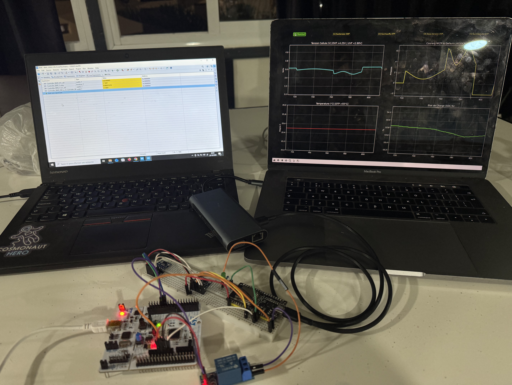
  </a>
</p>

**HIL Video (embedded playback if supported by GitHub):**


[▶ Watch the HIL Demonstration](https://github.com/user-attachments/assets/4895109e-6aa9-4a1c-a395-de6a9b9222aa)

The experimental bench combines an **ESP32 Node32S**, an **STM32 NUCLEO-L476RG**, two **SN65HVD230** transceivers, a safety relay, and a Python dashboard. The demonstration shows Li-ion cell emulation, **CAN communication at 500 kbit/s**, and real-time monitoring of measured quantities.

Nominal-operation, overvoltage (OVP), undervoltage (UVP), overtemperature (OTP), overcurrent (OCP), and CAN communication-loss tests are detailed in Part 2.

### 🎥 Video 2 — PIL Validation: Simulink ↔ STM32

<p align="center">
  <a href="https://github.com/user-attachments/assets/b72ff9d8-cc0f-4915-b42c-9496ed0b240d">
    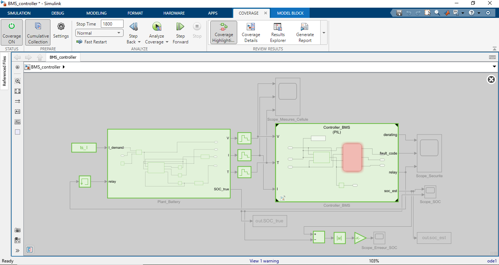
  </a>
</p>

**PIL Video (embedded playback if supported by GitHub):**

[▶ Watch the PIL Validation](https://github.com/user-attachments/assets/b72ff9d8-cc0f-4915-b42c-9496ed0b240d)

This demonstration presents the execution of **C code generated by Embedded Coder** on the **STM32L476RG**, while the battery model is simulated in MATLAB/Simulink. It allows the Processor-in-the-Loop validation, SOC estimation, and associated code coverage to be observed.

> Both images are retained as clickable previews, and both video URLs remain visible to allow embedded playback on GitHub when supported.

---


## Project Overview
 
This repository contains the complete implementation of an **automotive BMS controller**, from the physical modeling of a Li-ion cell to its validation on a real **Hardware-in-the-Loop** test bench:
 
1. a Li-ion cell (1-RC Thévenin model + thermal model) is modeled in Simulink and subjected to the **WLTP** driving cycle;
2. the **SOC** is estimated by an embeddable **neural network** (209 parameters, with no dynamic memory allocation);
3. a **Stateflow supervisor** manages operating modes and protections (overvoltage, undervoltage, overtemperature, overcurrent, communication loss);
4. C code is generated with **Embedded Coder**, progressively validated through **MIL → SIL → PIL**, and then deployed to an **STM32L476RG**;
5. the cell is then emulated on an **ESP32** communicating with the STM32 over **CAN 2.0B**; faults are injected in real time, and the response of the safety relay is measured.

### Key Figures
 
| Indicator | Value |
| --- | --- |
| Validation cycle | WLTP, 1800 s |
| SOC estimation error (PIL, code running on STM32) | MAE **0,233 %** · RMSE **0,345 %** · maximum **1,332 %** |
| Controller execution time (STM32 @ 80 MHz, DWT counter) | **≈ 1,3 ms** (≈ 104 000 cycles), representing 1,3 % of the 100 ms period |
| C code coverage (PIL) | functions **100 %** · statements **78 %** |
| HIL tests | **6 / 6** scenarios passed (nominal, 4 faults, CAN bus loss) |
| Safety chain, estimated worst case (assumptions below) | **≈ 111,5 ms** against a reference FTTI budget of 500 ms (77,7 % margin) |
 
> **Scope.** Academic project developed using an **ISO 26262-6-aligned** approach (traceability, MIL/SIL/PIL/HIL testing, structural coverage). No certification or type approval is claimed.
 
---
 
## Table of Contents
 
- [Part 1 — Model-Based Design: From the Simulink Model to PIL](#part-1--model-based-design-from-the-simulink-model-to-pil)
  - [1.1 Validation Approach](#11-validation-approach)
  - [1.2 Electrothermal Cell Model (Plant)](#12-electrothermal-cell-model-plant)
  - [1.3 Neural Network-Based SOC Estimation](#13-neural-network-based-soc-estimation)
  - [1.4 Stateflow Safety Supervisor](#14-stateflow-safety-supervisor)
  - [1.5 Code Generation and Target Configuration](#15-code-generation-and-target-configuration)
  - [1.6 MIL / SIL / PIL Results](#16-mil--sil--pil-results)
- [Part 2 — HIL Bench and Technical Validation](#part-2--hil-bench-and-technical-validation)
  - [2.1 Distributed Bench Architecture](#21-distributed-bench-architecture)
  - [2.2 CAN Protocol](#22-can-protocol)
  - [2.3 Plant Firmware (ESP32)](#23-plant-firmware-esp32)
  - [2.4 Controller Firmware (STM32)](#24-controller-firmware-stm32)
  - [2.5 Test Matrix and Experimental Results](#25-test-matrix-and-experimental-results)
  - [2.6 Real-Time Performance and FTTI Budget](#26-real-time-performance-and-ftti-budget)
  - [2.7 Issues Encountered and Solutions](#27-issues-encountered-and-solutions)
- [Repository Structure](#repository-structure)
- [Reproducing the Project](#reproducing-the-project)
- [Limitations and Future Work](#limitations-and-future-work)
- [Author](#author)
---
 
# Part 1 — Model-Based Design: From the Simulink Model to PIL
 
## 1.1 Validation Approach

 
The top-level model `BMS_controller.slx` clearly separates the **environment** (`Plant_Battery`) from the **controller** (`Controller_BMS`). The safety relay commanded by the controller is fed back into the plant: when it opens, the current applied to the cell drops to 0 A. The safety loop is therefore actually closed from the simulation stage onward.
 
<p align="center">
  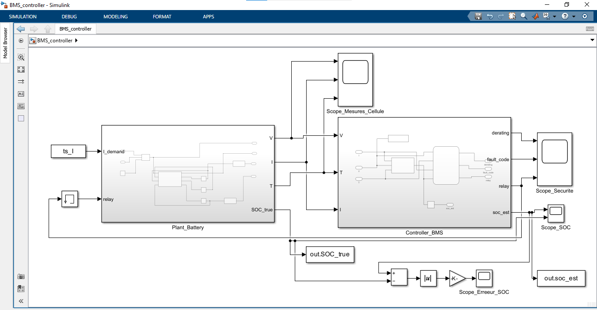
</p>

## 1.2 Electrothermal Cell Model (Plant)
 
A Thévenin model with one RC network, coupled to a first-order thermal model and Coulomb counting to provide the ground-truth SOC:
 
`V_cell(t) = V_oc(SOC) - R_0 × I(t) - V_1(t)`
 
`dV_1/dt = -V_1/(R_1 × C_1) + I/C_1`  
`dSOC/dt = -I/C_n`
 
`C_th × dT_cell/dt = R_0 × I² - hA × (T_cell - T_amb)`
 
Convention: `I > 0` during discharge, `I < 0` during regenerative braking. The open-circuit voltage `V_oc(SOC)` is represented by a nonlinear lookup table in Simulink and by a polynomial approximation in the ESP32 firmware.
 
| Parameter | Symbol | Value |
| --- | --- | --- |
| Nominal capacity | C_n | 2,50 Ah (9 000 As) |
| Ohmic internal resistance | R_0 | 20 mΩ |
| Polarization resistance | R_1 | 15 mΩ |
| Polarization capacitance | C_1 | 1 200 F (τ = R_1C_1 = 18 s) |
| Overall thermal capacity | C_th | 65 J/°C |
 
<p align="center">
  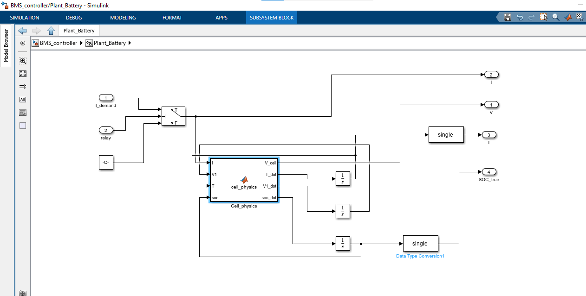
</p>
The `cell_physics` block computes the derivatives (`V1_dot`, `T_dot`, `soc_dot`); the integrators close the state loop. The relay acts as a switch on the requested current.
 
## 1.3 Neural Network-Based SOC Estimation
 
Coulomb counting alone drifts because measurement noise is integrated over time. A lightweight multilayer perceptron estimates SOC directly from the measurements:
 
| Element | Description |
| --- | --- |
| Inputs (3) | Current, voltage, and temperature normalized to [0, 1] |
| Hidden layer 1 | 16 neurons, ReLU |
| Hidden layer 2 | 8 neurons, ReLU |
| Output (1) | SOC ∈ [0, 1], sigmoid |
| Size | **209 parameters**: (3×16+16) + (16×8+8) + (8×1+1) |
 
Coulomb counting alone is expressed as:
 
`SOC_coulomb(t) = SOC(t_0) - (1/C_n) × ∫[t_0 → t] (I(τ) + ε_bruit) dτ`
 
The current sensor's offset and noise term `ε` is integrated over time, causing drift. The network avoids this integration: it directly computes the SOC from measurements through a feedforward inference process:
 
`z_1 = ReLU(W_1 × x + b_1)`  
`z_2 = ReLU(W_2 × z_1 + b_2)`  
`SOC_est = σ(W_3 × z_2 + b_3)`
 
Training is performed using the Deep Learning Toolbox (`RNA.m`). The weights are then extracted (`extract_weights.m`) as `const float` arrays, and inference is written in pure C (`soc_nn_core.m`): no `malloc`, no data-dependent loops, and thus a constant number of cycles from one execution to the next. A `Rate Limiter` smooths the `soc_est` output.
 
## 1.4 Stateflow Safety Supervisor
 
`Controller_BMS` combines the SOC estimator and a Stateflow finite-state machine that produces `derating`, `fault_code`, and `relay`.
 
<p align="center">
  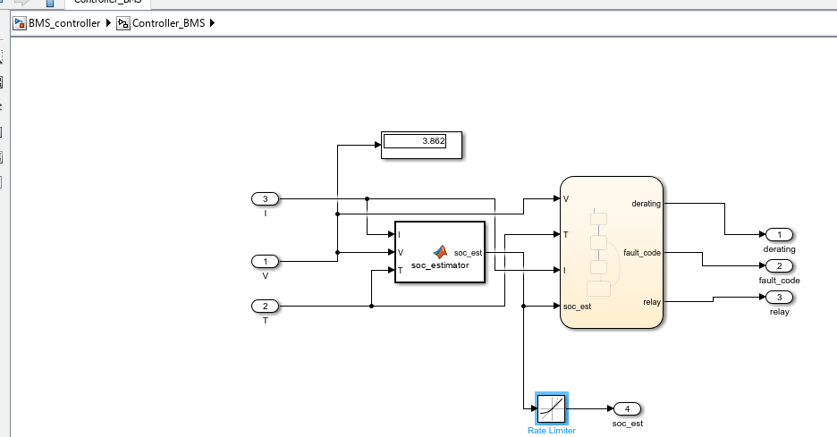
</p>
The chart contains four states; outputs are set upon entry into each state.
 
<p align="center">
  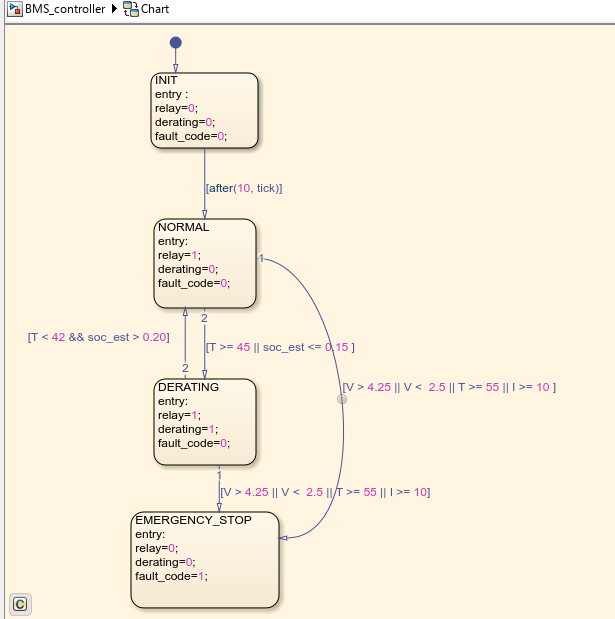
</p>

| State | `relay` | `derating` | `fault_code` | Role |
| --- | :---: | :---: | :---: | --- |
| `INIT` | 0 | 0 | 0 | Initialization, relay open; transition to `NORMAL` after 10 calculation steps (`after(10, tick)`) |
| `NORMAL` | 1 | 0 | 0 | Relay closed, continuous monitoring of V, I, T |
| `DERATING` | 1 | 1 | 0 | Preventive power limitation, relay kept closed |
| `EMERGENCY_STOP` | 0 | 0 | 1 | Safe State: relay open |
 
| Transition | Condition |
| --- | --- |
| `NORMAL` → `DERATING` | T ≥ 45 °C **or** estimated SOC ≤ 15 % |
| `DERATING` → `NORMAL` | T < 42 °C **and** estimated SOC > 20 % (hysteresis) |
| `NORMAL` / `DERATING` → `EMERGENCY_STOP` | V > 4,25 V **or** V < 2,5 V **or** T ≥ 55 °C **or** I ≥ 10 A |
 
| Fault | Trigger condition | Detection location |
| --- | --- | --- |
| Overvoltage (OVP) | V_cell > 4,25 V | Stateflow chart |
| Undervoltage (UVP) | V_cell < 2,5 V | Stateflow chart |
| Overtemperature (OTP) | T_cell ≥ 55 °C | Stateflow chart |
| Overcurrent (OCP) | I_cell ≥ 10 A (discharge current) | Stateflow chart |
| CAN communication loss | No frame received for more than 300 ms | STM32 firmware watchdog (`main.c`) |
 
In the chart, `EMERGENCY_STOP` is a latched state: it has no outgoing transition. To run successive bench tests without resetting the board, exit logic (return to healthy quantities, command `0`) was added in `Controller_BMS.c`.
 
## 1.5 Code Generation and Target Configuration
 
Code is generated using **Embedded Coder** (`ert.tlc`) for the NUCLEO-L476RG board through the STM32 support package: build, download, and execution via ST-LINK / SWD, with the *Reduced C* runtime library (`nano.specs`).
 
<p align="center">
  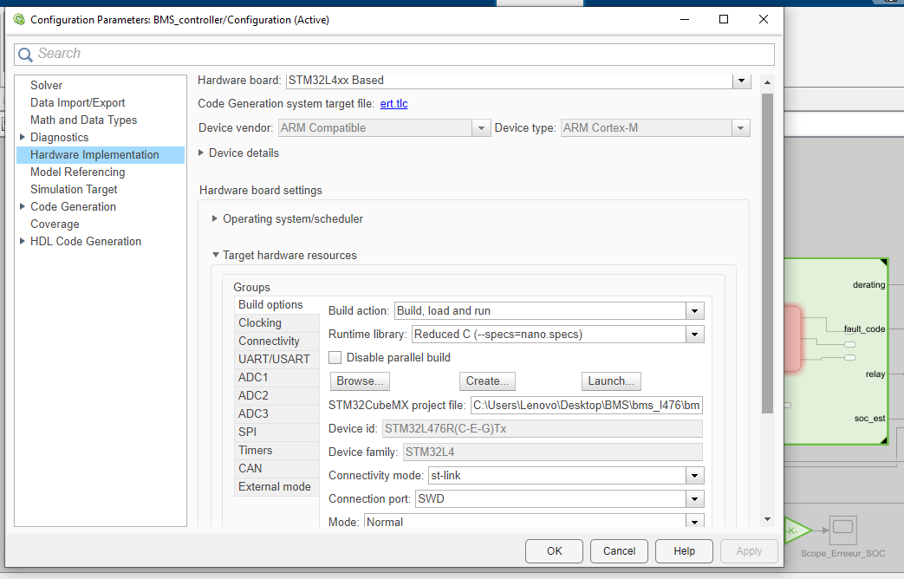
</p>
The associated **STM32CubeMX** project configures the CAN bus (bxCAN, 500 kbit/s: prescaler 10, 13 + 2 time quanta around the synchronization quantum, for a total of 16 quanta per bit) and the pins used by the bench.
 
<p align="center">
  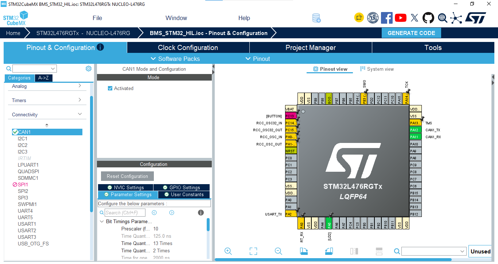
</p>

| Pin | Function |
| --- | --- |
| PA11 / PA12 | CAN1_RX / CAN1_TX (to the SN65HVD230 transceiver) |
| PA5 | Relay control and LD2 LED (Safe State) |
| PA2 / PA3 | USART (ST-LINK serial connection) |
| PA13 / PA14 | SWDIO / SWCLK (programming and debugging) |
 
## 1.6 MIL / SIL / PIL Results
 
The same WLTP excitation vectors are applied to the model (MIL), the C code compiled on the host (SIL, *back-to-back* comparison), and then the code running on the STM32 (PIL). This approach progressively verifies functional behavior, generated-code execution, and operation on the physical target.

### MIL Validation (Model-in-the-Loop)

In **MIL** mode, the controller algorithms (`Controller_BMS`) are evaluated directly in MATLAB/Simulink in closed loop with `Plant_Battery`. This level serves as the functional reference: SOC estimation behavior, Stateflow transitions, and relay control in response to the cell model.

### SIL Validation (Software-in-the-Loop)

In **SIL** mode, the C code generated from `Controller_BMS` by Embedded Coder is compiled and executed on the host computer while remaining connected to the simulated plant. The *back-to-back* comparison between MIL and SIL aims to detect differences potentially introduced by code generation, numeric types, or execution of the production software.

SIL therefore represents an intermediate step between model validation and execution on the microcontroller. It does not replace PIL/HIL tests: the real target and peripherals have not yet been exercised.

<p align="center">
  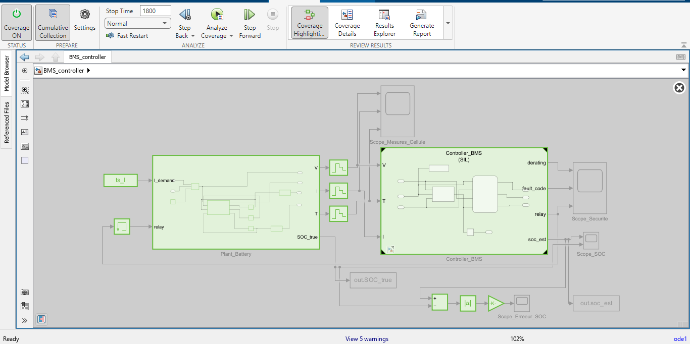
</p>

### Back-to-Back Validation (MIL vs SIL)

The direct comparison between model simulation (**MIL**) and execution of the compiled C code (**SIL**) in the *Simulation Data Inspector* shows **2 Match, 0 Mismatch** for the compared signals over the **1800 s** WLTP cycle. The overlapping curves and the difference displayed in the comparison window illustrate agreement between the two executions for this scenario and the configured tolerances.

<p align="center">
  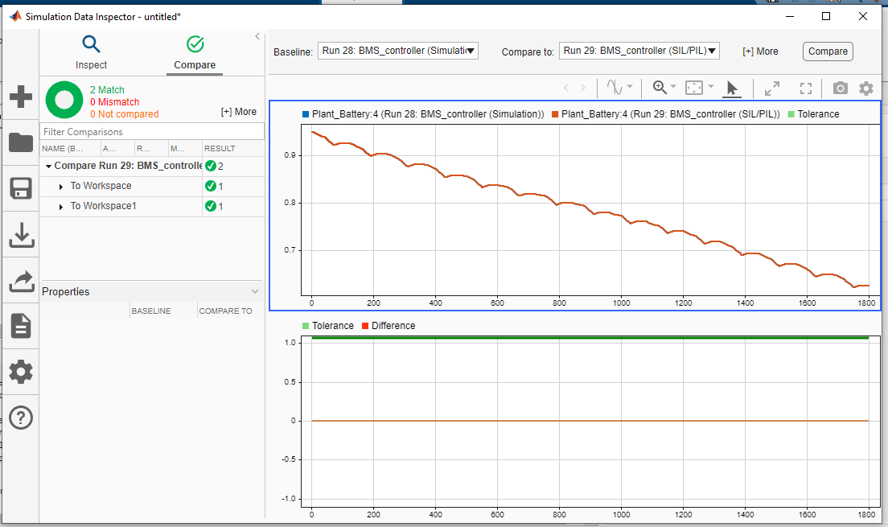
</p>

This result serves as a non-regression check for the signals actually compared; it does not, by itself, mean that every safety path was exercised. **PIL** validation on the STM32 and **HIL** validation over the CAN bus complete the process.

### PIL Validation (Processor-in-the-Loop) — STM32L476RG

In **PIL** mode, the generated code runs on the ARM Cortex-M4F core of the STM32L476RG, while the battery model and simulation campaign remain on the host computer. This stage verifies the behavior of the program compiled for the target and makes it possible to observe its performance on the hardware.

SOC estimation follows the reference throughout the 1800 s cycle (SOC decreasing from approximately 95 % to 63 %).
 
<p align="center">
  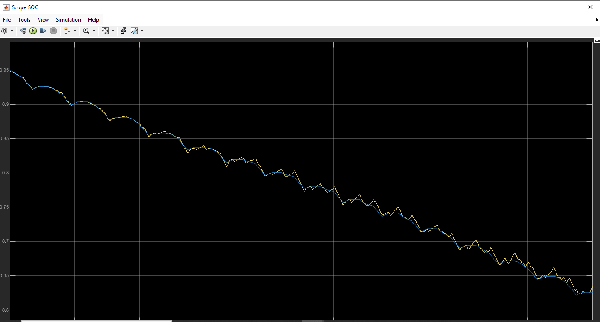
</p>
The absolute error remains below 1,4 percentage points throughout the cycle; it increases toward the end of the cycle, when the current demands become more pronounced.
 
<p align="center">
  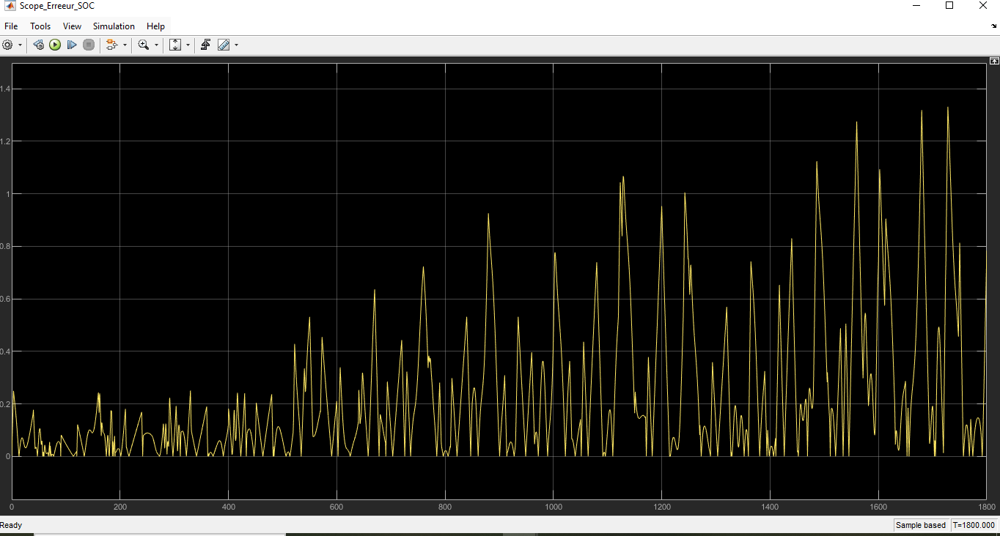
</p>

| Metric (PIL, STM32L476RG) | Value | Project acceptance criterion |
| --- | --- | --- |
| WLTP cycle duration | 1800 s (full cycle) | 1800 s |
| Maximum ΔSOC error | 1,332 % | < 3,0 % |
| Mean absolute error (MAE) | 0,233 % | < 1,0 % |
| Root mean square error (RMSE) | 0,345 % | < 1,5 % |
| Function coverage (C code) | 100 % | 100 % |
| Statement coverage (C code) | 78 % | > 70 % |
 
The PIL simulation runs with **Simulink Coverage** enabled: the `Controller_BMS (PIL)` block runs on the target while the rest of the model remains on the host. Red areas indicate elements not exercised during this nominal cycle; the fault paths are exercised separately during the HIL test campaign (Part 2). The MC/DC coverage report is available in `Model_Based_Design_Simulink/Rapport_Coverage_Securite_MCDC.html`.
 
<p align="center">
  
</p>

<p align="center">
  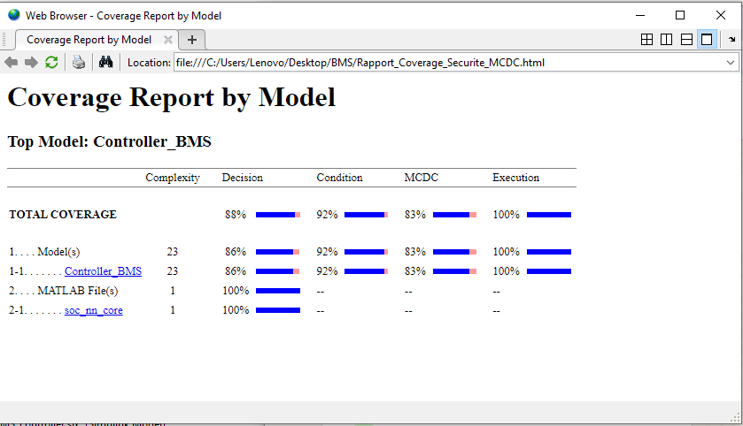
</p>
---
 
# Part 2 — HIL Bench and Technical Validation
 
## 2.1 Distributed Bench Architecture
 
The cell is taken out of the simulation and emulated in real time on a dedicated microcontroller. The BMS controller now receives only CAN frames, just as it would in a vehicle.
 
 
<p align="center">
  
</p>

| Subsystem | Hardware reference | Role |
| --- | --- | --- |
| Plant (emulator) | ESP32 Node32S (dual-core, 240 MHz) | Cell emulation, WLTP profile, fault injection |
| BMS ECU | NUCLEO-L476RG (Cortex-M4F, 80 MHz) | Generated-code execution, safety diagnostics, relay control |
| CAN transceivers | 2 × SN65HVD230 | 3,3 V interface to the differential CANH / CANL lines |
| Safety actuator | Single-channel relay module + green status LED | Opening the circuit in Safe State, remote visibility of the relay status |
| Monitoring workstation | PC | Python dashboard, scenario injection, STM32CubeIDE |
 
## 2.2 CAN Protocol
 
The bus operates at **500 kbit/s**. The ESP32 broadcasts a standard frame with identifier `0x100` every **100 ms** (10 Hz):
 
```text
ID : 0x100 | DLC : 5 | 11-bit standard identifier | big-endian bytes
```
 
| Bytes | Signal | Type | Resolution | Physical range |
| --- | --- | --- | --- | --- |
| 0 – 1 | Cell voltage | `uint16_t` | 1 mV / bit | 0 to 65,535 V |
| 2 – 3 | Cell current | `int16_t` | 10 mA / bit (1 cA) | −327,68 to +327,67 A |
| 4 | Temperature | `int8_t` | 1 °C / bit | −128 to +127 °C |
 
Current is transmitted in **centiamperes**: when expressed in mA, an `int16_t` is limited to ±32,767 A, so 35 A would overflow; in cA, the range reaches ±327,67 A. On the STM32 side, decoding divides voltage by 1000 and current by 100.
 
## 2.3 Plant Firmware (ESP32)
 
Files: `Firmware_ESP32_Plant/BMS_Plant_ESP32.ino` and `wltp_data.h`.
 
- Deterministic 10 Hz loop: reads the WLTP current profile, performs Coulomb counting, computes RC dynamics, calculates voltage, and runs a simplified thermal model.
- **TWAI** driver (ESP32 CAN controller) configured at 500 kbit/s.
- Live fault injection through the serial connection:
| Command | Scenario | Forced quantity |
| --- | --- | --- |
| `0` | Nominal | WLTP profile |
| `1` | Overvoltage (OVP) | V_cell = 4,30 V |
| `2` | Overtemperature (OTP) | T_cell = 60 °C |
| `3` | Undervoltage (UVP) | V_cell = 2,20 V |
| `4` | Overcurrent (OCP) | I_cell = 35 A |
 
## 2.4 Controller Firmware (STM32)
 
Files: `Firmware_STM32_Controller/BMS_STM32_HIL/Core/Src/main.c` and `Controller_BMS.c` (generated code).
 
- **Interrupt-driven reception**: `HAL_CAN_RxFifo0MsgPendingCallback()` filters identifier `0x100`, decodes the frame, and directly feeds the model inputs (`Controller_BMS_U.V_cell`, `.I`, `.T`).
- **One calculation step per frame**: `Controller_BMS_step()` executes the SOC estimator and Stateflow; the `Controller_BMS_Y.relay` output drives pin PA5.
- **Communication watchdog**: the timestamp of the last valid frame is compared against `HAL_GetTick()`; if more than 300 ms pass without a frame, the relay is opened (fail-safe behavior).
- **Performance measurement**: hardware cycle counter `DWT->CYCCNT` around model execution.

## 2.5 Test Matrix and Experimental Results
 
### Validation Matrix
 
| Test | Event | Injected value (ESP32) | Detection threshold (STM32) | Safety action (PA5 / relay) | Result |
| --- | --- | --- | --- | --- | --- |
| TC-01 | Nominal driving | WLTP profile | Quantities within safe ranges | Relay closed, external LED off (LD2 follows PA5) | **PASS** |
| TC-02 | Overvoltage (OVP) | V_cell = 4,30 V | V_cell > 4,25 V | Immediate shutdown | **PASS** |
| TC-03 | Overtemperature (OTP) | T_cell = 60,0 °C | T_cell ≥ 55,0 °C | Immediate shutdown | **PASS** |
| TC-04 | Undervoltage (UVP) | V_cell = 2,20 V | V_cell < 2,50 V | Immediate shutdown | **PASS** |
| TC-05 | Overcurrent (OCP) | I_cell = 35,0 A | I_cell ≥ 10,0 A | Immediate shutdown | **PASS** |
| TC-06 | CAN bus loss | CANH disconnection | Timeout > 300 ms | Fail-safe action | **PASS** |
 
### Dashboard Telemetry During Fault Injection
 
The Python dashboard displays V, I, T, and SOC in real time; the green button indicates the active scenario. Each screenshot shows the instant when the fault is applied.
 
| **Overvoltage (OVP)**: at t ≈ 815 s, the voltage rises to 4,30 V, above the 4,25 V threshold. | **Undervoltage (UVP)**, first test campaign: voltage forced to 2,50 V, equal to the strict threshold (V < 2,5 V); the injected value was subsequently reduced to 2,20 V. |
| :---: | :---: |
| 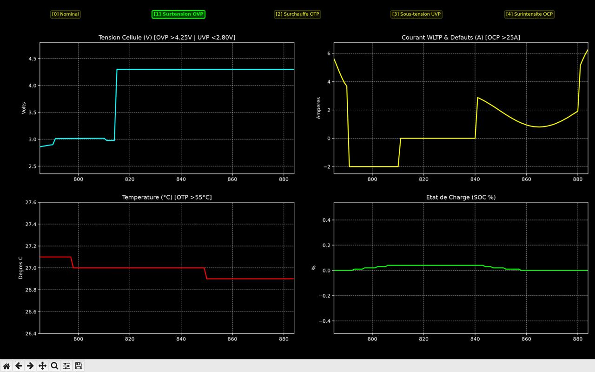 | 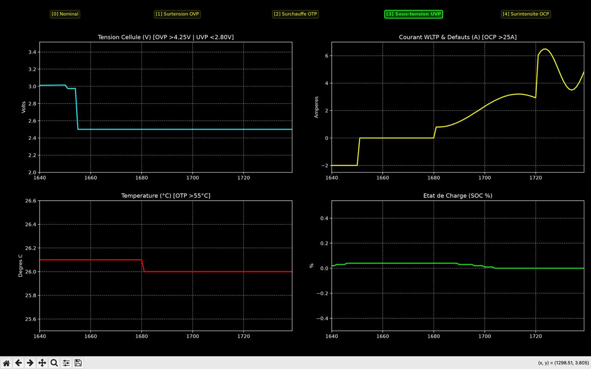 |
 
| **Overcurrent (OCP)**: at t ≈ 583 s, current rises to 35 A; voltage drops to around 2,25 V and then continues to decrease, while temperature increases linearly (Joule heating). | **Overtemperature (OTP)**: at t ≈ 1354 s, temperature rises from approximately 34 °C to 60 °C, exceeding the 55 °C threshold. |
| :---: | :---: |
| 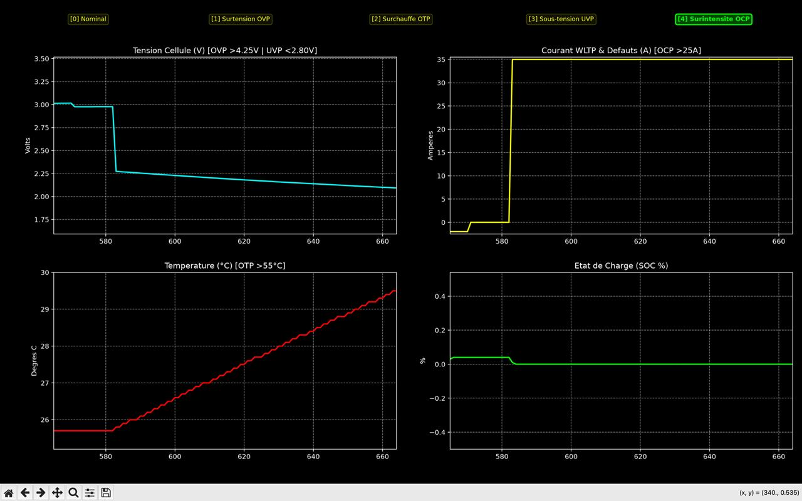 | 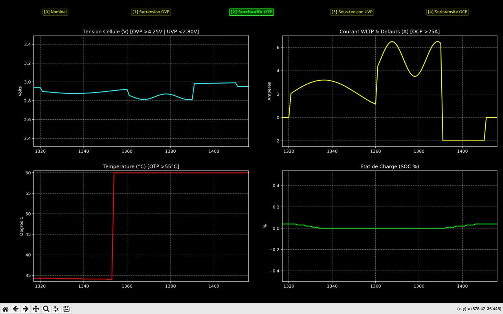 |
 
> The chart titles show initial display thresholds (UVP 2,80 V, OCP 25 A). The controller's actual thresholds are those of the Stateflow chart (2,5 V and 10 A). Because the relay is not fed back to the plant, the forced quantity remains applied until command `0` is sent.
 
### Controller Variable Readings (Live Expressions)
 
| Command | Scenario | V_cell | Stateflow state | Relay | Behavior |
| --- | --- | --- | --- | --- | --- |
| `0` | Nominal | 3,68 V | `4` (`IN_NORMAL`) | `1` (closed) | Nominal operation |
| `1` | OVP | 4,30 V | `2` (`EMERGENCY_STOP`) | `0` (open) | Immediate shutdown |
| `2` | OTP | 3,32 V (T = 60 °C) | `2` (`EMERGENCY_STOP`) | `0` (open) | Thermal fault detected |
| `3` | UVP | 2,20 V | `2` (`EMERGENCY_STOP`) | `0` (open) | Below the 2,50 V threshold |
| `4` | OCP | 2,73 V (I = 35 A) | `2` (`EMERGENCY_STOP`) | `0` (open) | Current threshold exceeded |
 
At 35 A, the internal resistance causes both an instantaneous voltage drop (V = V_oc − R_0·I) and Joule heating P = R_0·I² ≈ 24,5 W, validating the model's electrothermal coupling before controller shutdown.
 
<p align="center">
  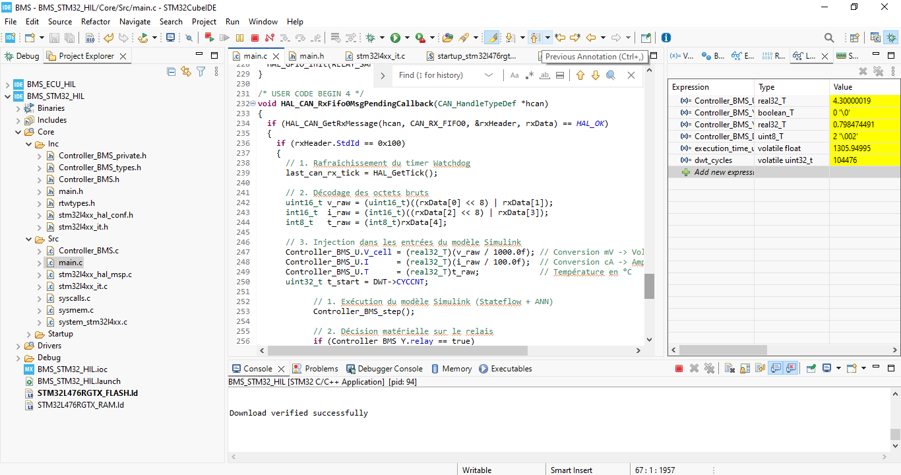
</p>


### Relay Status and Safe State Visualization

A green LED is wired to the safety circuit to provide remote visual indication of the system status:

- **Off** = relay closed during nominal operation (`NORMAL` mode).
- **On** = relay open / Safe State active following a fault (`EMERGENCY_STOP` mode).

The NUCLEO's LD2 LED also follows pin PA5. Note: the **external green LED** may have a different active polarity from the **onboard LD2**; the states above describe the external LED convention used on the bench.

| Wiring overview (ESP32, 2 × SN65HVD230, NUCLEO, relay, status LED) | Safety trip (green LED on, relay open) |
| :---: | :---: |
| 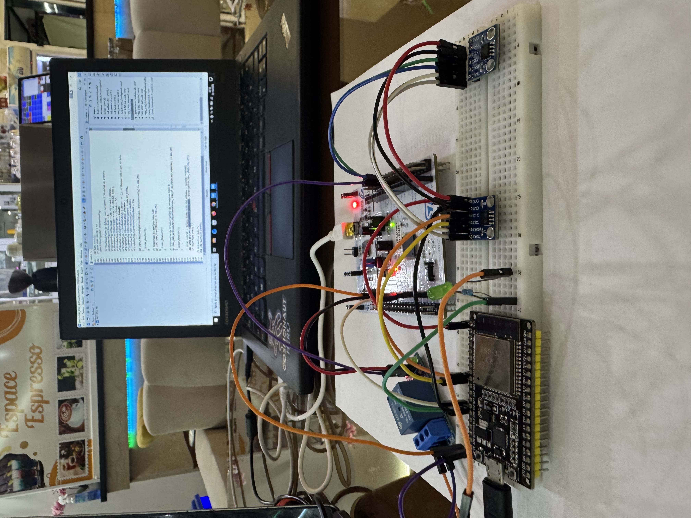 | 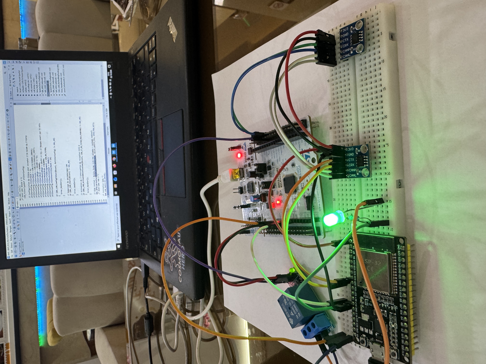 |

> **Display convention:** the controller's logical states (`relay = 1` in nominal operation, `relay = 0` in emergency stop) are distinct from the external LED's illuminated state. An LED being lit in a photograph is not, on its own, proof that the relay contacts have electrically opened; the actual mode is confirmed through the command signals and bench tests.

## 2.6 Real-Time Performance and FTTI Budget
 
Measured using the DWT cycle counter on the Cortex-M4 at 80 MHz: **≈ 102 500 to 104 700 cycles**, equivalent to **≈ 1,28 to 1,31 ms** for neural-network inference, the Stateflow machine, and relay control. This represents **1,3 %** of the 100 ms CAN period.

The screenshots below show the cycle-counter measurements in both operating modes, without extrapolating the relay's electromechanical switching time from the DWT measurements.

| Nominal execution on STM32 | Execution during an OVP overvoltage fault |
| :---: | :---: |
| 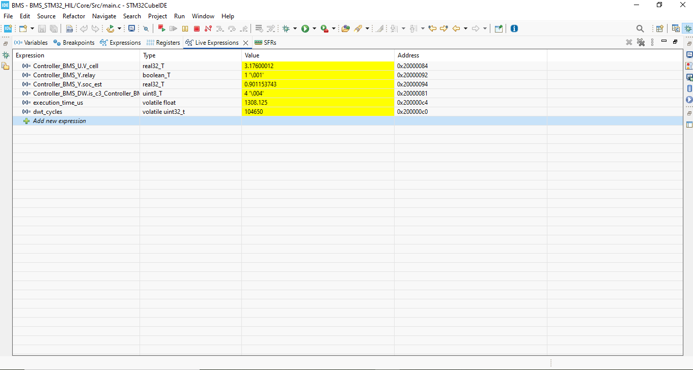 | 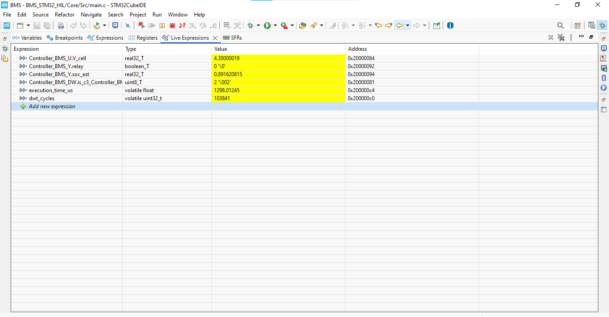 |
 
| Contribution to response time (worst-case estimate) | Duration |
| --- | --- |
| Frame transmission interval (fault occurring just after a frame) | 100 ms |
| CAN transmission of a 5-byte frame at 500 kbit/s | ≈ 0,2 ms |
| Controller execution on STM32 | ≈ 1,3 ms |
| Mechanical relay switching (typical value) | ≈ 10 ms |
| **Total** | **≈ 111,5 ms** |
 
`T_réaction = T_période_CAN + T_transmission + T_contrôleur + T_relais`  
`T_réaction ≈ 100 + 0,2 + 1,3 + 10 = 111,5 ms`
 
Against a reference FTTI of 500 ms (a project sizing assumption), the estimated margin is **77,7 %**. This calculation is a theoretical timing budget (including an assumed ≈ 10 ms for the relay), not a comprehensive measurement of the physical shutdown time. Communication loss is detected after 300 ms, also below this budget.
 
## 2.7 Issues Encountered and Solutions
 
| Issue | Solution |
| --- | --- |
| `int16_t` overflow with a 35 A current | Transmit current in centiamperes |
| Hardware pin-assignment conflict on PA5 (relay / LD2) | Reconfigure pins in STM32CubeMX |
| CAN reception interrupt not triggered | Configure CAN filter and validate the `CAN1_RX0_IRQHandler` handler |
| No response to a communication loss | 300 ms watchdog with automatic relay opening |
| UVP scenario not detected at the original injected value | Reduce the injected value to 2,20 V to strictly cross the model's 2,50 V threshold |
| Controller stuck in `EMERGENCY_STOP` between tests | Add exit logic when quantities return to healthy values (command `0`) |
 
---
 
## Repository Structure
 
```text
Automotive-BMS-MBD-HIL/
├── Model_Based_Design_Simulink/     # Simulink models, MATLAB scripts, reports
│   ├── BMS_controller.slx           #   top-level model (plant + controller)
│   ├── Controller_BMS.slx           #   controller: ANN estimator + Stateflow
│   ├── init_bms.m, CELLULE.m        #   cell model and parameters
│   ├── RNA.m, extract_weights.m     #   training and weight extraction
│   ├── soc_nn_core.m                #   embeddable inference
│   ├── RAPPORT1800.pdf              #   full WLTP-cycle report
│   └── Rapport_Coverage_Securite_MCDC.html
├── Firmware_STM32_Controller/
│   └── BMS_STM32_HIL/               # STM32CubeIDE project (generated code + main.c)
├── Firmware_ESP32_Plant/            # Arduino firmware for the cell emulator
│   ├── BMS_Plant_ESP32.ino
│   └── wltp_data.h
└── docs/
    ├── image/                       # Screenshots, diagrams, bench photographs
    │   ├── bms.png, battery.png     #   model architecture and plant
    │   ├── controller.png, F3.png   #   estimator and Stateflow machine
    │   ├── CONFG2.png, STMFINAL.png #   STM32 and CAN configuration
    │   ├── SIL_FINAL.png            #   SIL mode screenshot
    │   ├── SILETPILGRAPHE.png       #   back-to-back MIL / SIL comparison
    │   ├── IMG_1358.png            #   complete HIL bench and monitoring
    │   ├── IMG_1340.png            #   bench wiring
    │   ├── IMG_1336.png            #   bench status LED
    │   ├── NOMINAL_DWT.png, ovp_dwt.png # execution-time measurements
    │   ├── Rapport_Coverage_MCDC_BMS.png # coverage report screenshot
    │   ├── FINALPIL.png             #   estimated and reference SOC
    │   ├── ERROR_PIL_FINAL.png      #   SOC error in PIL
    │   └── PIL_FINAL.png            #   Simulink Coverage in PIL
    └── video/                       # Demonstration videos
```
 
## Reproducing the Project
 
**Software prerequisites**: MATLAB, Simulink, Stateflow, Embedded Coder, Deep Learning Toolbox, Simulink Coverage, Embedded Coder STM32 support package, STM32CubeMX, STM32CubeIDE, Arduino IDE (or PlatformIO) with the ESP32 package.
 
1. **Simulation (MIL)**: open MATLAB in `Model_Based_Design_Simulink/`, run `init_bms.m`, open `BMS_controller.slx`, and simulate for 1800 s.
2. **Code generation and SIL**: generate the controller C code with Embedded Coder; execute the controller in SIL mode on the host and compare its outputs against the MIL results using the same WLTP stimuli.
3. **PIL validation**: under *Configuration Parameters → Hardware Implementation*, specify the local STM32CubeMX project, then run the PIL simulation of the `Controller_BMS` block on the NUCLEO-L476RG.
4. **STM32 firmware**: open `Firmware_STM32_Controller/BMS_STM32_HIL` in STM32CubeIDE, build it, and flash the NUCLEO-L476RG.
5. **ESP32 firmware**: open `BMS_Plant_ESP32.ino` (with `wltp_data.h`), select an ESP32 board, and upload the firmware.
6. **CAN wiring**: ESP32 → SN65HVD230 no. 1; CANH ↔ CANH, CANL ↔ CANL, common ground; SN65HVD230 no. 2 → PA11 (RX) / PA12 (TX); relay input on PA5.
7. **Testing**: open the ESP32 serial monitor at 115 200 baud and send `0` through `4` to inject scenarios; observe the relay, LD2 LED, and STM32CubeIDE *Live Expressions*.

## Limitations and Future Work
 
- The relay is not fed back to the plant on the HIL bench (no return frame): an injected fault remains applied until command `0` is issued, whereas the relay → current loop is closed in simulation (MIL/PIL).
- The chart outputs a single `fault_code`: the fault type is not yet distinguished in the output.
- The exit logic for `EMERGENCY_STOP` was added to the generated code; moving it into the Stateflow chart would preserve model ↔ code traceability when regenerating the code.
- Only one cell is modeled; managing a full pack (balancing, multiple cells in series) is not covered.
- The cell is emulated at 10 Hz: the bench validates safety logic and controller response time, not the behavior of a real cell.
- C code statement coverage is 78 % in PIL on the nominal cycle; extending PIL tests with fault scenarios could bring coverage closer to 100 %.
- Moving to a multi-cell high-voltage pack would require modeling balancing and dedicated measurement ICs (such as BQ76PL455 or LTC6811).
- Future directions: comparison with an extended Kalman filter, SOH estimation based on changes in R_0, sensor noise and diagnostics, migration to CAN FD, and a bench using a real cell and current sensor.

---

## Author

**SEDDOUKI Nacereddine**  
Embedded Systems & Robotics Engineer (Master MST-SER)  
Faculty of Sciences and Technology of Al Hoceima (FSTH)  
GitHub profile: [@seddouki18](https://github.com/seddouki18)
